<div align="center">
  
</div>

<br>



<br>


<br>


<br>

<table>
<tr>
<td width="62%" valign="top">

**Soumalya Sarkar**, working under the artistic name **INKTENEBRIS**.

I'm an artist and graphic designer first. My thing is dark, surreal ballpoint-pen illustration. Photoshop is where I clean up scans and turn them into finished visuals.

Code is the newer obsession. I'm learning Python, SQL, and the web stack (HTML, CSS, and JavaScript), mostly to build small tools, websites, and eventually make the art itself interactive.

</td>
<td width="38%" valign="top">

```text
name   : soumalya sarkar

as     : inktenebris

role   : artist / designer / dev
```

</td>
</tr>
</table>


<br>

<table>
<tr>
<td width="50%" valign="top">

**currently into**

- edm, dubstep, above everything
- gaming
- open-source software
- creative coding
- tech in general

</td>
<td width="50%" valign="top">

**learning goals**

- ship python tools end to end
- get properly comfortable with sql on mysql
- build real front-ends with html, css and js
- put the art on a site of my own
- contribute to open source

</td>
</tr>
</table>

<br>


<br>


<br>

<!--START_SECTION:waka-today-->
<table>
<tr>
<td width="50%" valign="top">

**☀️ TODAY'S CODING**

<!--WAKATIME_TODAY_TIME-->
`2 hrs 29 mins`

<sub>2026-11-01 · Asia/Kolkata</sub>


</td>
<td width="50%" valign="top">

**📅 LAST 7 COMPLETED DAYS**

`Waiting for the first successful update.`

</td>
</tr>
</table>
<!--END_SECTION:waka-today-->

<!--START_SECTION:waka-->
📊 **This Week I Spent My Time On** 

```text
🕑︎ Time Zone: Asia/Kolkata

💬 Programming Languages: 
HTML                     15 mins             ██████░░░░░░░░░░░░░░░░░░░   24.66 % 
YAML                     15 mins             ██████░░░░░░░░░░░░░░░░░░░   24.21 % 
Markdown                 15 mins             ██████░░░░░░░░░░░░░░░░░░░   23.92 % 
CSS                      9 mins              ████░░░░░░░░░░░░░░░░░░░░░   15.28 % 
JavaScript               5 mins              ██░░░░░░░░░░░░░░░░░░░░░░░   09.03 % 

🔥 Editors: 
VS Code                  1 hr 3 mins         █████████████████████████   100.00 % 

💻 Operating System: 
Linux                    1 hr 3 mins         █████████████████████████   100.00 % 
```


 Last Updated on 01/11/2026 11:30:34 UTC
<!--END_SECTION:waka-->


<br>


<br>

<table>
<tr>
<td width="50%">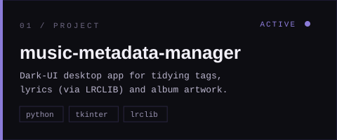</td>
<td width="50%">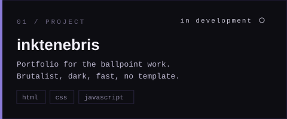</td>
</tr>
<tr>
<td width="50%">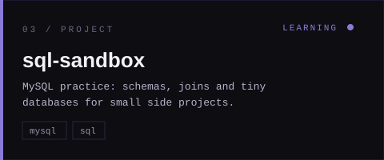</td>
<td width="50%">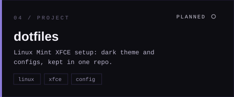</td>
</tr>
</table>

<br>


<br>


<br>


<br>

<a href="https://github.com/soumalyasarkar"></a>

<a href="https://instagram.com/inktenebris_art"></a>

<a href="mailto:soumalyasarkar61@gmail.com"></a>

<br>

<br>


<div align="right"><sub>soumalya sarkar / inktenebris // 2026</sub></div>
